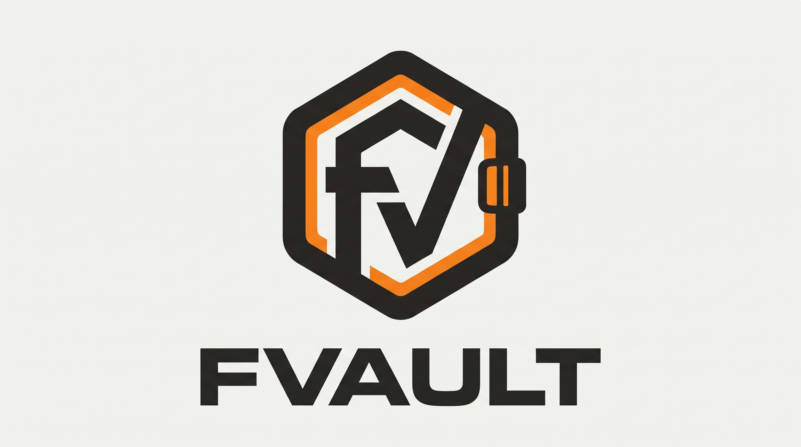

# fvault



> **Your passwords, encrypted.** One Master Password instead of a plaintext
> Markdown file — folders, tags, CLI and web, with backups you can take with you.

A small, self-hosted password vault with a command-line interface and a web UI.
The vault is encrypted at rest with a Master Password, organized into folders,
and can back itself up locally and to a mounted remote folder.

Use whichever you prefer — the CLI or the Web UI; both control the same
encrypted vault.

## Why fvault?

I originally kept my own passwords in a Markdown file. It was convenient, but
plaintext secrets in a notes file felt unsafe and not something I was
comfortable with, so I decided to build a proper system instead: everything is
encrypted with a Master Password, organized into folders and tags, and usable
from both a CLI and a web UI. That is why fvault exists.

Pushing this repository to GitHub is intentionally left to me.

## Features

- **Argon2id + AES-256-GCM** encryption for the whole vault.
- **Single user**, multiple folders (`server-1`, `server-2`, `personal`, ...).
- **CLI** with an interactive menu, scriptable commands, and JSON list output.
- **Web UI** with server-side sessions, CSRF protection, and a login rate limit.
- **Search** by name, username, URL, or notes; select a result and copy it.
- **Clipboard auto-clear** after 30 seconds (configurable).
- **Tags and pinned/favorite entries** in addition to folders.
- **Fuzzy search** by name, username, URL, notes, and tags.
- **Entry templates** for server, database, API token, and SSH key.
- **CSV and JSON import/export**, plus Bitwarden and 1Password import.
- **Password history**, duplicate detection, and an audit log.
- **Dark mode**, keyboard shortcuts, and a PWA manifest for the web UI.
- **Markdown import** for migrating from a simple notes file.
- **Automatic backups** to a local folder and/or a mounted remote folder,
  with retention by snapshot count and total size.
- **Systemd and nginx examples** for deployment behind HTTPS.

## Requirements

Ensure the following tools are installed on your Linux or macOS system:

- **Go 1.26+**: The required compiler.
- **Clipboard tool**: Needed for the `--copy` feature (e.g., `xclip`, `xsel`, `wl-copy`, or `pbcopy`).
- **Nginx/Certbot & Systemd**: Optional, for production deployment.

## Getting started

### New users

If you are cloning this repository for the first time:

```bash
# 1. Build and install the binary and web assets.
#    This installs 'fvault' to ~/.local/bin and assets to ~/.local/share/fvault.
./scripts/install.sh

# 2. Run the start command.
#    It creates a vault if one does not exist, asks for a Master Password,
#    configures backups, and opens the CLI menu.
fvault start
```

Already keeping passwords in a notes file? Import it straight away instead of
typing every entry:

```bash
fvault import-md passwords.md --folder imported
fvault import-csv passwords.csv
fvault import-json passwords.json
fvault import-1password 1password-export.csv
```

On subsequent runs, just use `fvault start` to open your vault and access the menu.

### Existing users

- **Updating fvault**: run `./scripts/install.sh` again. Your vault data in
  `data/` (or `FVAULT_HOME`) is never touched by an update.
- **Moving to a new computer**: see [Moving to a new computer](#moving-to-a-new-computer).

## Moving to a new computer

This is for an **existing user** who has a vault on the old machine and wants
every entry, folder, and tag on the new one.

### 1. Old computer — export the encrypted vault

Pick whichever way you like:

```bash
fvault backup export ~/Desktop/vault-transfer.json
```

- CLI menu: `fvault` -> `6) Backup` -> `8) Export vault (for new PC)`.
- Web UI: open `/backup` and click **Download encrypted vault**.

The exported file stays encrypted, so it is safe to copy over USB, an external
drive, or a cloud folder.

### 2. Move the file

Copy `vault-transfer.json` to the new computer.

### 3. New computer — install and restore

```bash
./scripts/install.sh
fvault backup restore ~/Desktop/vault-transfer.json
# -> enter the same Master Password, then type RESTORE
fvault start
```

`fvault backup restore` works even when the new machine has no vault yet: it
verifies the file first, then writes `vault.json`.

Quickest alternative: copy `data/vault.json` from the old computer into
`./data/` (or point `FVAULT_HOME` at that folder) and run `fvault start` with
the same Master Password.

You do **not** need to transfer `secret.key` (web sessions only, recreated
automatically) or `settings.json` (set it again with `fvault backup setup`).
If a remote backup folder is configured, the snapshots are already stored
there — the new computer can run `fvault backup restore latest` instead.

## Web UI

The web UI can be launched from the CLI menu, or directly:

```bash
fvault serve
```

The server scans ports `8000-8099` by default. Log in with the username
you chose during setup and your Master Password.

For production deployment behind a reverse proxy (e.g., nginx), use a fixed port:

```bash
fvault serve --host 127.0.0.1 --port 17384 --cookie-secure --trust-proxy
```

## Data layout

By default, data lives in `./data` (relative to your current directory).
Set `FVAULT_HOME` to change this location.

```text
data/
  vault.json       encrypted vault (safe to back up)
  secret.key       web session secret (not the vault key)
  settings.json    backup configuration
  backups/         local snapshots
```

`vault.json` is the only file that contains secrets. It is encrypted with a key
derived from the Master Password. The Master Password is never stored. If you
lose it, the vault cannot be recovered.

## Vault format

```json
{
  "version": 1,
  "kdf": { "name": "argon2id", "time": 3, "memory_kib": 65536, "threads": 4, "salt": "..." },
  "aead": { "name": "aes-256-gcm", "nonce": "..." },
  "ciphertext": "..."
}
```

The encrypted payload contains the username, timestamps, folders, and entries.
Folder and entry names must match `^[A-Za-z0-9][A-Za-z0-9._-]{0,63}$`.
The `general` folder always exists and cannot be removed.

## CLI

```text
fvault init [--username NAME] [--no-backup]
fvault start [--username NAME] [--no-backup]
fvault add <folder>/<name> [--username U] [--generate] [--length N]
fvault edit <folder>/<name> [--username U] [--tags T] [--pinned|--unpin] [--password P] [--generate] [--length N]
fvault get <folder>/<name> [--copy] [--field password|username] [--show]
fvault list [--folder NAME] [--json]
fvault search <query> [--folder NAME] [--copy]
fvault remove <folder>/<name>
fvault folder add <name>
fvault folder list
fvault folder remove <name> [--force]
fvault passwd
fvault import-md <file.md> [--folder NAME] [--dry-run] [--overwrite]
fvault import-csv <file.csv> [--folder NAME] [--dry-run] [--overwrite]
fvault export-csv <file.csv>
fvault import-json <file.json> [--folder NAME] [--dry-run] [--overwrite]
fvault export-json <file.json>
fvault import-bitwarden <export.json> [--folder NAME] [--dry-run] [--overwrite]
fvault import-1password <export.csv> [--folder NAME] [--dry-run] [--overwrite]
fvault backup setup
fvault backup config show
fvault backup config set --mode none|local|local+remote|remote \
  [--local-dir DIR] [--remote-dir DIR] [--keep N] [--max-size MB] \
  [--remote-on-write] [--strict]
fvault backup status
fvault backup create [--label TEXT]
fvault backup list
fvault backup sync
fvault backup prune
fvault backup verify [file|--all]
fvault backup restore <file|latest>
fvault backup export <destination>
fvault doctor [--no-decrypt]
fvault serve [--host H] [--port auto|0|N] [--cookie-secure] [--trust-proxy]
fvault menu
```

Global flag: `--home DIR` (or `FVAULT_HOME`).

### Copy behavior

`get --copy` and `search --copy` write to the system clipboard and start a
detached helper that clears the clipboard after 30 seconds, but only if the
clipboard still contains the copied value. Set `FVAULT_CLIPBOARD_CLEAR_SECONDS`
to change the delay (`0` disables the timer).

## Markdown import

```markdown
## github
username: octocat
password: correct-horse-battery-staple
url: https://github.com
notes: personal account

## mail
username: me@example.com
password: hunter2
url: https://mail.example.com
```

```bash
fvault import-md secrets.md --folder personal --dry-run
fvault import-md secrets.md --folder personal
```

Lines may start with an optional `- `. Unknown keys are ignored. Existing
entries are skipped unless `--overwrite` is passed.

## Web UI

- Log in with the vault username and Master Password.
- Search and browse entries by folder.
- Reveal or copy a password for one entry at a time. There is no bulk reveal.
- Create, edit, and delete entries and folders.
- View backup status and download an encrypted vault export for a new PC.

### Security model

- Argon2id: `time=3`, `memory=64 MiB`, `threads=4`, 16-byte salt, 32-byte key.
- AES-256-GCM with a fresh random nonce on every save.
- AAD binds the version, KDF parameters, salt, and AEAD name to the ciphertext.
- Sessions are stored in server memory; the cookie only contains a random ID.
- Cookies are `HttpOnly` and `SameSite=Lax`; add `--cookie-secure` behind HTTPS.
- Every state-changing form requires a CSRF token.
- **3 failed logins lock the IP for 15 minutes** (configurable).
- Login errors are generic and do not reveal whether the username or password
  was wrong.
- The vault is decrypted in memory only while the server is running.

### Limitations

- Single-user only. There is no multi-user account system.
- Sessions and rate-limit state are in memory. Restarting the server logs
  everyone out and resets lockouts. Run one process per vault.
- A forgotten Master Password cannot be recovered.
- The server must be run over HTTPS when exposed to a network. Use the bundled
  nginx example and a TLS certificate.
- The web UI can reveal a password to the authenticated browser. Protect the
  host and use a strong Master Password.

## Backups

Backups are opt-in at `init`/`start` or with `fvault backup setup`.

Modes:

- `none`: disabled.
- `local`: snapshots in `data/backups`.
- `local+remote`: local snapshots plus a copy in a mounted remote folder.
- `remote`: remote folder only.

A remote folder must already exist, be mounted, and be writable. `fvault` writes
a `.fvault-target` marker to prevent accidentally using the wrong directory.
Remote failures produce a warning by default; set `--strict` to make them fatal.

Retention defaults to **10 snapshots** and **50 MB** total per target. Duplicate
content is skipped using a SHA-256 hash. Backups are encrypted exactly like the
vault.

For moving to a new PC, the CLI backup menu offers `Export vault (for new PC)`
and `Restore vault from file`; the web UI offers the same export as a download.

Scheduled sync with systemd:

```bash
sudo cp scripts/fvault-backup.service scripts/fvault-backup.timer /etc/systemd/system/
sudo systemctl daemon-reload
sudo systemctl enable --now fvault-backup.timer
```

## Deployment

The application is a single Go binary. Templates and static files are loaded
from disk. When installed via `./scripts/install.sh`, assets are located in
`~/.local/share/fvault/`.

Example layout:

```text
/opt/fvault/bin/fvault
/opt/fvault/templates/
/opt/fvault/static/
/opt/fvault/scripts/
/var/lib/fvault/          # data, owned by the fvault user
```

Deployment steps remain similar for production servers using systemd and nginx
as described in the `scripts/` examples.

## Environment variables

| Variable | Default | Purpose |
| --- | --- | --- |
| `FVAULT_HOME` | `./data` | Data directory |
| `FVAULT_HOST` | `127.0.0.1` | Web bind address |
| `FVAULT_PORT` | `auto` | `auto`, `0`, or a fixed port |
| `FVAULT_COOKIE_SECURE` | `false` | Mark the session cookie `Secure` |
| `FVAULT_TRUST_PROXY` | `false` | Trust `X-Forwarded-For` |
| `FVAULT_SESSION_TTL_MINUTES` | `30` | Session lifetime |
| `FVAULT_MAX_ATTEMPTS` | `10` | Failed logins before lockout |
| `FVAULT_LOCKOUT_MINUTES` | `15` | Lockout duration |
| `FVAULT_CLIPBOARD_CLEAR_SECONDS` | `30` | Clipboard auto-clear delay |
| `FVAULT_TEMPLATES` | `templates` | Template directory |
| `FVAULT_STATIC` | `static` | Static file directory |

## Development


```bash
export PATH="$HOME/.local/go/bin:$PATH"
go build ./...
go vet ./...
go test ./...
```

See [docs/TROUBLESHOOTING.md](docs/TROUBLESHOOTING.md) for common problems.
# fvault
